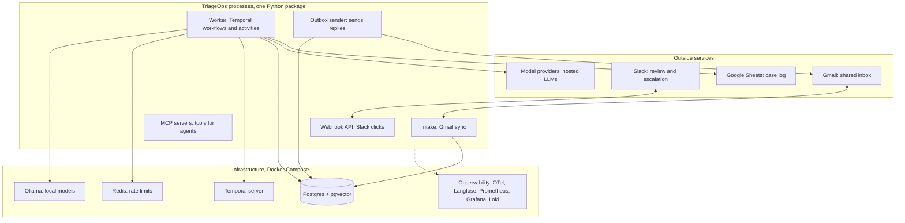
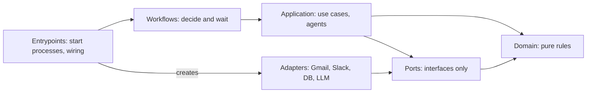

# TriageOps — Software Architecture

Nov 8, 2026 · @aRT

## Summary and principles

TriageOps is a **modular monolith** built with **ports and adapters** (hexagonal architecture): one Python package, run as a few processes, where the core logic never talks to Gmail, Slack, a model provider or the database directly.

This document describes how the code is organized inside. The system design (what TriageOps does and why) lives in *TriageOps — Project Documentation*. Keep this file in the repo at `docs/architecture/software-architecture.md` and update it at the end of every phase.

**Principles**

1. **The core knows nothing about the outside world.** Business rules and use cases depend only on small interfaces (ports). Real services plug in through adapters.
2. **Dependencies point inward.** Entrypoints and adapters depend on the application layer; the application layer depends on the domain; the domain depends on nothing.
3. **One codebase, several processes.** Intake, workflow worker, webhook API and MCP servers are separate processes started from the same package. No microservices.
4. **Workflows decide; activities act.** Temporal workflow code contains only orchestration decisions. Every side effect happens in an activity that calls an application use case.
5. **Validate at the edges.** Data from outside (emails, Slack payloads, model output, config) is validated into typed models as it enters. Inside, code trusts its types.
6. **Every side effect is idempotent and recorded.** Sends go through the outbox; every decision is written to the audit log.
7. **Grow only when a phase needs it.** Start with the smallest version of each layer; add ports and adapters as phases introduce them.

**Why this shape**

- **Testable:** swap real adapters for fakes and test use cases in milliseconds, with no network.
- **Replaceable:** changing Gmail for another mail provider, or one model provider for another, means writing one adapter.
- **Fits Temporal:** deterministic workflows and side-effecting activities map directly onto "decide" and "act".
- **Explainable:** each folder has one job, which makes the code easy to walk through in an interview.

## Containers

TriageOps runs as five processes started from the same package, on shared infrastructure in Docker Compose; outside services are reached only through adapters.



The outbox sender also calls Gmail to deliver replies; n8n, when used, is an extra intake entrypoint beside the intake service. Langfuse, Prometheus, Grafana and Loki sit together under Observability.

| Process | Started by | Job |
| --- | --- | --- |
| Intake | `entrypoints/intake.py` | Sync Gmail by history ID (push later), call `ingest_email`, start or signal workflows |
| Webhook API | `entrypoints/webhook_api.py` | Verify and handle Slack interactions; signal workflows; health checks |
| Worker | `entrypoints/worker.py` | Run Temporal workflows and activities (separate pools for intake, models, sending from Phase 13) |
| Outbox sender | `entrypoints/outbox_sender.py` | Deliver pending outbox rows exactly once |
| MCP servers | `entrypoints/mcp_servers/` | Expose Gmail, Slack, Sheets, knowledge base and TriageOps status as tools |

## Layers

The code has six layers, and dependencies only point toward the domain; outside services enter only through adapters that implement ports.



Arrow = depends on. Adapters implement ports; entrypoints create adapters and pass them in.

| Layer | Job | Contains | Never contains |
| --- | --- | --- | --- |
| Domain | The business rules | Models (Email, Thread, Case, Draft), state transitions, rules such as "reply only to the original sender" | I/O, SDKs, frameworks |
| Application | One use case per task | `ingest_email`, `classify_email`, `draft_reply`, `review`, `send_reply`, `escalate`, agents | Vendor SDKs, Temporal code |
| Ports | What the core needs from outside | Python `Protocol` interfaces such as `MailboxPort`, `LLMPort`, `PolicyPort` | Implementations |
| Adapters | How to talk to each outside service | Gmail, Slack, Sheets, Postgres, LiteLLM, OPA, Presidio, MCP client, fakes | Business decisions |
| Workflows | When to do what, durably | Temporal workflows, activities, the Phase 3 runner | Direct I/O inside workflow code |
| Entrypoints | How each process starts | Intake, worker, webhook API, outbox sender, MCP servers, CLI, `wiring.py` | Business rules |

## Folder layout

Each folder maps to one layer or one kind of adapter; this is the target layout at v1.0, built up phase by phase.

```text
triageops/
  src/triageops/
    domain/                 # pure rules and models; no I/O, no frameworks
      models.py             # Email, Thread, Case, Category, Classification, Draft, Decision
      rules.py              # state transitions, escalation rules, reply-address rule
      errors.py             # domain errors (InvalidTransition, ...)
    application/            # use cases; orchestrate domain + ports
      ingest_email.py       # dedupe, store, decide start-or-signal
      classify_email.py
      draft_reply.py
      review.py             # post card, handle approve/edit/reject
      send_reply.py         # write to outbox
      escalate.py
      delete_sender_data.py
      agents/               # LangGraph graphs and prompts (use LLMPort, ToolPort)
    ports/                  # interfaces only (Python Protocols)
      mailbox.py  chat.py  case_log.py  repositories.py  outbox.py
      audit.py  llm.py  embeddings.py  knowledge.py  policy.py
      redactor.py  tools.py  clock.py
    adapters/               # implementations of ports
      gmail/  mailpit/  slack/  sheets/
      postgres/             # repositories, outbox, audit, pgvector search
      llm/                  # LiteLLM, fake LLM for tests
      opa/  presidio/  mcp_client/
      fakes/                # in-memory fakes for every port
    workflows/              # orchestration only
      runner_v0/            # hand-built durable runner (Phase 3; kept for comparison)
      thread_workflow.py    # Temporal workflow
      activities.py         # thin wrappers calling application use cases
    entrypoints/            # processes and their wiring
      intake.py             # Gmail watch/poll -> ingest_email
      worker.py             # Temporal worker(s)
      webhook_api.py        # FastAPI: Slack interactions, health
      outbox_sender.py      # delivers outbox rows
      mcp_servers/          # gmail, slack, sheets, kb, triageops
      cli.py                # verify-audit, replay-dlq, reindex
    wiring.py               # builds adapters from settings, injects them
    settings.py             # typed settings from env and config files
  config/                   # categories.yaml, routing.yaml, slo.yaml
  policy/                   # OPA Rego policies and their tests
  migrations/               # database schema migrations
  tests/
    unit/  integration/  contract/  e2e/
  evals/                    # datasets, judge, attack suite
  chaos/                    # Toxiproxy scenarios, load tests
  docs/
    architecture/software-architecture.md
    decisions/  failure-drills/  system-card.md
    learning/  project/
  docker-compose.yml
  CLAUDE.md  PROGRESS.md  README.md
```

**What goes where, quickly**

- A rule that would still be true with no computer ("replies go only to the original sender") → `domain/`
- A sequence of steps for one task ("classify, check policy, draft") → `application/`
- "Something we need from the outside world" → an interface in `ports/`
- "How we talk to Gmail, Slack, Postgres" → `adapters/`
- "When to do what, durably" → `workflows/`
- "How the program starts and gets its dependencies" → `entrypoints/` and `wiring.py`

## Ports and their adapters

Every outside dependency sits behind a port. Each port has a real adapter and an in-memory fake used in tests.

| Port | What it promises | Real adapter | Fake for tests | Added in phase |
| --- | --- | --- | --- | --- |
| `MailboxPort` | List changes since a history ID; get a message; send a reply in a thread to its original sender | Gmail | In-memory mailbox; Mailpit for integration | 1 |
| `CaseRepository` | Save and load emails, threads, cases; dedupe by `Message-ID` | Postgres | In-memory dict | 1 |
| `Clock` | Current time (so tests control time) | System clock | Fixed clock | 2 |
| `LLMPort` | Return validated structured output for a prompt and schema; report tokens and cost | LiteLLM (hosted models, Ollama) | Canned responses | 5 |
| `ChatPort` | Post a review card, update it in place, post to a channel | Slack | Recorder | 6 |
| `OutboxRepository` | Add a pending send in the same transaction as a state change; mark delivered | Postgres | In-memory list | 6 |
| `CaseLogPort` | Upsert a row per case | Google Sheets | Recorder | 6 |
| `EmbeddingPort` | Turn text into vectors | LiteLLM or a local embedding model | Deterministic fake vectors | 7 |
| `KnowledgeSearchPort` | Hybrid search and rerank help-doc passages | Postgres + pgvector | Fixed passages | 7 |
| `ToolPort` | Call a named tool with validated input | MCP client | Recorder | 8 |
| `RedactorPort` | Remove personal data from text | Presidio | Simple regex fake | 9 |
| `PolicyPort` | Decide allow, deny or needs-approval for an action | OPA | Table of fixed answers | 9 |
| `AuditLog` | Append a hash-chained entry; verify the chain | Postgres | In-memory chain | 12 |

**Port design rules**

- Ports are written as Python `Protocol` classes in `ports/`, using domain models in their signatures, never vendor types (no Gmail message objects leak past the adapter)
- One port per outside capability; keep each small (3–5 methods)
- Adapters translate vendor errors into a few clear error types (`TransientError`, `PermanentError`, `RateLimited`, `AuthExpired`) so retry logic stays generic
- Every adapter has a **contract test** that runs the same checks against the real adapter (in integration) and the fake (in unit tests), so the fake cannot drift

## Rules

These rules keep the layers honest; break one only with a decision record explaining why.

**Dependency rules**

| Layer | May import | Must not import |
| --- | --- | --- |
| `domain` | Python standard library, Pydantic | anything else in the project; any SDK |
| `application` | `domain`, `ports` | `adapters`, `workflows`, `entrypoints`, any vendor SDK |
| `ports` | `domain` | everything else |
| `adapters` | `domain`, `ports`, vendor SDKs | `application`, `workflows`, `entrypoints` |
| `workflows` | `domain`, `application` (via activities), Temporal SDK | `adapters` directly |
| `entrypoints` and `wiring.py` | everything | — (this is where things are connected) |

Enforce it automatically from Phase 1 with an import-rules check in CI (for example `import-linter`), so a wrong import fails the build.

**Where I/O is allowed**

- **Allowed:** adapters, entrypoints, Temporal activities (through use cases and ports)
- **Not allowed:** domain code, workflow code, prompt-building code
- Time and randomness come from ports (`Clock`) or Temporal's own APIs, never called directly inside workflows or domain code

**Validation boundaries**

- Emails are parsed and validated into `Email` models in the Gmail adapter
- Slack payloads are signature-checked and validated in `webhook_api.py`
- Model output is validated against Pydantic schemas in the LLM adapter (validate → repair → retry)
- Config files are validated into typed settings at startup; the program refuses to start on bad config
- Inside the core, code trusts its typed models and does not re-validate

**Errors**

- Adapters raise one of: `TransientError` (retry), `RateLimited` (retry after a delay), `AuthExpired` (refresh or stop), `PermanentError` (do not retry; record)
- Domain rules raise domain errors (for example `InvalidTransition`); these are bugs or bad input, never retried
- Temporal retry policies are configured by error type: transient and rate-limited are retried; permanent and domain errors are marked non-retryable
- After the final retry, the item goes to the dead-letter table with its error and trace ID

**Configuration and secrets**

- `settings.py` reads environment variables and `config/*.yaml` into one typed settings object
- Secrets come only from environment or the secrets manager, never from YAML in the repo
- `wiring.py` is the only place that chooses real versus fake adapters

## How Temporal, agents and MCP fit the layers

Temporal sits above the application layer as the orchestrator; agents live inside the application layer; MCP appears twice, as a way agents reach tools and as a way outside clients reach TriageOps.

**Temporal**

- `ThreadWorkflow` (in `workflows/`) holds the case state machine, timers and signal handlers. It calls only activities.
- Each activity in `workflows/activities.py` is a thin wrapper: it gets dependencies from `wiring.py` and calls one application use case (`classify_email`, `draft_reply`, `send_reply`, …).
- Signals come from entrypoints: the intake service (new email) and the webhook API (Slack button clicks).
- Because use cases do not depend on Temporal, the hand-built runner from Phase 3 and Temporal call the **same** use cases. Only the orchestrator changes, which makes the Phase 4 comparison fair.

**Agents**

- LangGraph graphs live in `application/agents/`. They are use cases with a loop inside.
- They reach models through `LLMPort` and tools through `ToolPort`; they never import an SDK directly.
- The supervisor enforces step, token and cost caps, and returns a typed result (`Draft` with citations, or `NeedsHuman` with a reason).
- Agent runs happen inside activities, so a crash mid-run retries the activity, and the result is stored once.

**MCP, inward (agents using tools)**

- `adapters/mcp_client/` implements `ToolPort` by calling MCP servers.
- Each MCP server in `entrypoints/mcp_servers/` is a thin layer over application use cases or adapters, exposing only the operations its tool allows (the Gmail server's send tool takes a thread ID, never an address).

**MCP, outward (TriageOps as a tool)**

- `entrypoints/mcp_servers/triageops.py` exposes read-only status operations ("what is waiting for approval?") so an MCP client such as Claude Desktop can query the system.

**n8n**

- n8n is an integration entrypoint, not part of the core. It may handle Gmail triggers and notifications, then call TriageOps' webhook API or start or signal a workflow. No business rules live in n8n.

## Data ownership

Each table has one owning use case or adapter that writes it; everything else only reads it, and schema changes go through migrations.

| Table or store | Holds | Written by | Phase |
| --- | --- | --- | --- |
| `emails` | One row per message, unique on `Message-ID` | `ingest_email` | 1 |
| `threads` | One row per Gmail thread, linked to its workflow | `ingest_email` | 1 |
| `sync_state` | Last processed Gmail history ID, watch expiry | Gmail intake adapter | 2 |
| `cases`, `case_steps`, `timers` | Hand-built runner state (kept for comparison after Phase 4) | `runner_v0` | 3 |
| Temporal history | Workflow state and event history | Temporal server | 4 |
| `llm_calls` | Tokens, cost, model, prompt version per call | LLM adapter | 5 |
| `outbox` | Pending and delivered sends, with idempotency keys | `send_reply` (insert), `outbox_sender` (deliver) | 6 |
| `review_cards` | Slack message timestamp per case, for in-place updates | `review` | 6 |
| `kb_chunks` | Help-doc chunks, embeddings, source and version | Indexer (`cli reindex`) | 7 |
| `dead_letters` | Failed items with error and trace ID | Worker error handler | 13 |
| `audit_log` | Hash-chained decision records | `AuditLog` adapter only | 12 |
| Google Sheet | Human-readable case log (a view, not the source of truth) | `CaseLogPort` | 6 |

**Rules**

- Postgres is the source of truth for cases; the Google Sheet is a convenience copy
- A state change and its outbox row are written in **one transaction**
- `audit_log` is append-only: no updates, no deletes, except the redaction path in the deletion workflow, which itself writes an audit entry
- Personal data lives in `emails` and the outbox; other tables store IDs and redacted text where possible, so deletion is simple

## Testing by layer

The layers decide the test strategy: most tests run against fakes in milliseconds, and only a few touch real services.

| Layer | Test type | Uses | Example |
| --- | --- | --- | --- |
| `domain` | Unit | Nothing (pure functions) | An invalid state transition raises `InvalidTransition` |
| `application` | Unit | Fakes for every port | `ingest_email` with the same `Message-ID` twice stores one row |
| `adapters` | Contract + integration | Real service or local stand-in (Postgres, Mailpit, OPA) | The Gmail and fake mailbox both pass the same contract tests |
| `workflows` | Workflow tests | Temporal test environment with time skipping; fake activities | Escalation fires after 48 hours of simulated time |
| `entrypoints` | Integration | Webhook API with a test client | A Slack request with a bad signature is rejected |
| Whole system | End to end (few) | Docker Compose stack, Mailpit, a test Slack workspace | Email in Mailpit → card posted → approve → one reply |
| Model behavior | Evals | Golden datasets, judge, attack suite | Classification accuracy stays above the threshold |
| Policies | OPA unit tests | Rego test files | Refund of ₱8,000 requires manager approval |
| Resilience | Chaos and load | Toxiproxy, k6 or Locust | 1,000 emails in a burst: no losses, no duplicates |

**Rules**

- Normal test runs never call real Gmail, Slack or paid model APIs
- Every port's fake passes the same contract tests as its real adapter
- Architecture rules are tested too: the import-rules check runs in CI
- A bug fix always comes with a test at the lowest layer that can catch it

## How the architecture grows, phase by phase

Start with the smallest version and add a layer or port only when a phase needs it; update this document at the end of every phase.

| Phase | What appears in the architecture |
| --- | --- |
| 0 | Project skeleton: `src/triageops/`, `settings.py`, tests folder, Docker Compose with Postgres |
| 1 | `domain/models.py` (Email, Thread); `MailboxPort` and `CaseRepository`; Gmail, Mailpit, Postgres and fake adapters; `entrypoints/intake.py`; `wiring.py`; import-rules check in CI; **architecture v1 written** |
| 2 | `Clock` port; adapter error types; retry helper; `sync_state` table |
| 3 | `domain/rules.py` (state machine); `application/` use cases with placeholder logic; `workflows/runner_v0/` |
| 4 | `workflows/thread_workflow.py` and `activities.py`; worker entrypoint; runner\_v0 kept for comparison |
| 5 | `LLMPort` and the LiteLLM adapter; `classify_email` and `draft_reply` use cases; hand-written agent loop in `application/` |
| 6 | `ChatPort`, `OutboxRepository`, `CaseLogPort`; Slack, Sheets and outbox adapters; `webhook_api.py`; `outbox_sender.py` |
| 7 | `EmbeddingPort`, `KnowledgeSearchPort`; pgvector adapter; `cli reindex` |
| 8 | `application/agents/` with LangGraph; `ToolPort` and the MCP client adapter; `entrypoints/mcp_servers/`; n8n as an intake entrypoint |
| 9 | `RedactorPort` (Presidio), `PolicyPort` (OPA); `policy/` folder with Rego tests |
| 10 | `evals/` datasets and runner; eval gate in CI |
| 11 | Tracing set up in `entrypoints` and passed through activities and adapters |
| 12 | `AuditLog` port and adapter; `cli verify-audit`; deletion use case |
| 13 | Circuit breakers in adapters; separate worker pools; `dead_letters` table and `cli replay-dlq`; Gmail push watch in intake |
| 14 | Fine-tuned classifier added as another model behind `LLMPort` (no other layer changes) |
| 15 | Final review of this document against the code; diagrams refreshed |

Phase 14 shows the payoff: a new model is a configuration change behind an existing port, not a rewrite.

## Decision records to write

Each major architecture choice gets a short record in `docs/decisions/` (template in the AI Tutor Guide), written in the phase where the choice is made.

| # | Decision | Phase |
| --- | --- | --- |
| 001 | Modular monolith instead of microservices | 1 |
| 002 | Ports and adapters (hexagonal) for all outside dependencies | 1 |
| 003 | Enforcing import rules in CI | 1 |
| 004 | Polling with history IDs first, push later | 2 |
| 005 | Hand-built runner versus Temporal | 4 |
| 006 | Transactional outbox for sends and Slack posts | 6 |
| 007 | Hybrid search with reranking instead of vectors only | 7 |
| 008 | Raw agent loop versus LangGraph | 8 |
| 009 | Agents reach tools through MCP | 8 |
| 010 | n8n as an intake entrypoint only, no business rules | 8 |
| 011 | OPA for business rules instead of code | 9 |
| 012 | Hash-chained audit log | 12 |
| 013 | Fine-tuned classifier versus prompting | 14 |

**Questions this architecture prepares you for**

- Why a modular monolith and not microservices?
- How do ports and adapters make testing easier? Show me a test that uses a fake.
- What happens if you switch from Gmail to another mail provider?
- Where is I/O allowed, and how do you enforce it?
- How do Temporal workflows and your use cases relate?
- How did adding a fine-tuned model affect the rest of the code?
